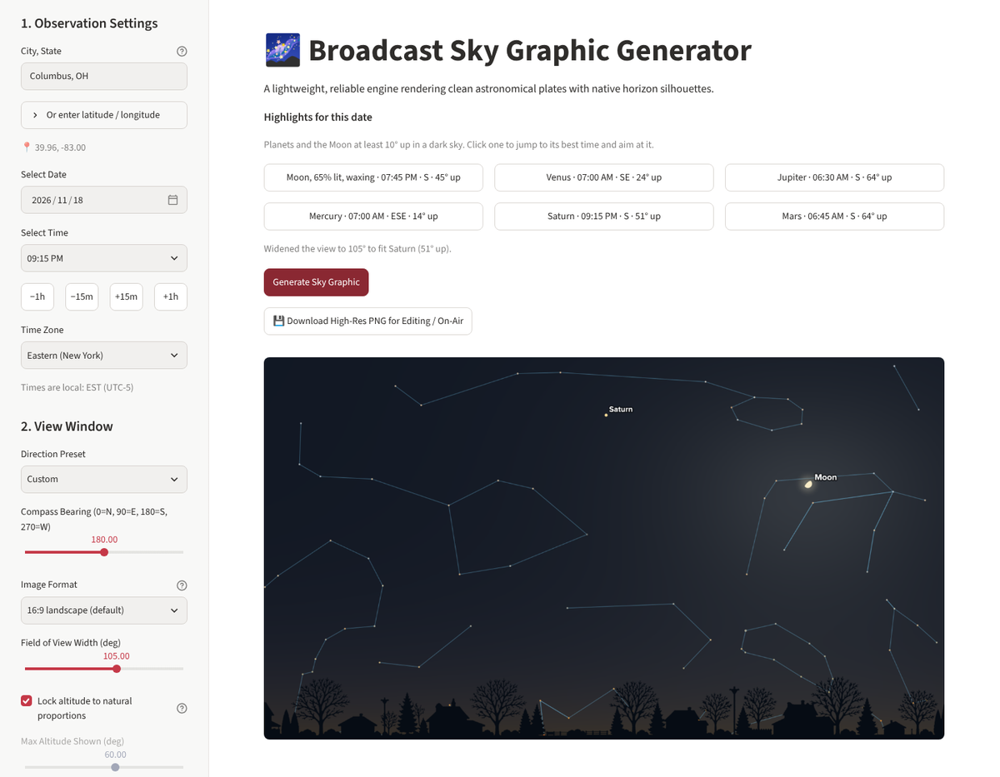
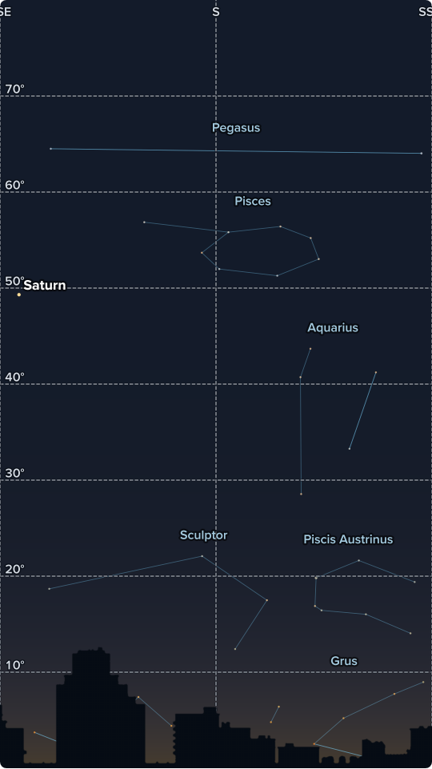
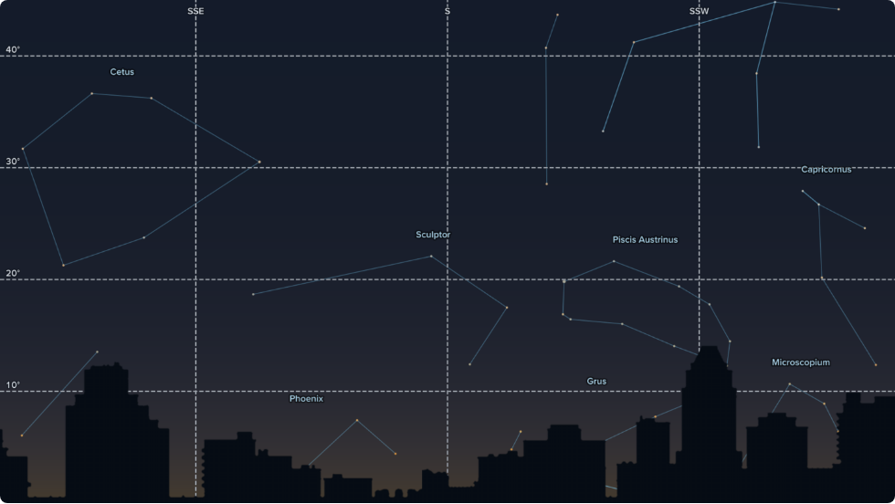

<!--
  Help text for the Astrographics tab (public page and configurator).
  Normal Markdown. Screenshots live in content/images/ and are written as .
  Change the app's address in content/apps.json, not here.
-->
## Astrographics

Astrographics draws the night sky for any place and time: stars, constellations, planets and the Moon, in front of a silhouette of the horizon. You set where, when and which way to look, and it returns a clean, transparent-friendly image to bring into Max or post to social media.

*Columbus at 9:15 PM after clicking the Saturn highlight (the app turned the view south and widened it to 105 degrees) and then Generate, with a suburban horizon.*

### What it can do

- **Any place.** Type a city and state, or enter a latitude and longitude. The time zone and the local time follow.
- **Any date and time.** The sky is computed for the moment you pick, including the planets, the Moon and its phase. Refraction near the horizon is included. Under the time box, **-1h**, **-15m**, **+15m** and **+1h** buttons step the time without opening the menu, handy for watching a planet rise or the Moon move.
- **Highlights for this date.** At the top of the page the app suggests views: the planets and the Moon that are at least 10 degrees up in a dark sky on the date you chose. Each button shows the object (the Moon also shows its phase), its best time, the direction and how high it is, for example "Saturn - 09:15 PM - S - 51 degrees up". Click one and the app sets the time to that best time and turns the view toward the object. If the object is high in the sky it also widens the field of view and the maximum altitude so it fits, and says so under the buttons. Then click **Generate Sky Graphic**. You can still change anything afterward.
- **Which way to look.** Pick North, Northeast and so on, or set an exact compass bearing. The field of view (30 to 160 degrees) and the maximum altitude shown (20 to 90) are adjustable. **Lock altitude to natural proportions** (on by default) sets the maximum altitude from the field of view for you; untick it to set it yourself.
- **A horizon that fits the place.** Urban, suburban and rural horizon silhouettes are included, and the horizon follows the **Star Visibility Limit** setting: 1.5 or lower shows the urban skyline, 2.0 to 3.0 a suburban neighborhood, and anything darker the rural country horizon. Tree foliage can follow the season automatically, or be set to leaves or bare.
- **Sky conditions.** Atmospheric haze and a star visibility limit are suggested from your location (a city sky shows fewer stars than a rural one). Both stay adjustable.
- **Clouds.** Off by default so astronomy graphics stay clear. In Forecast mode it draws the low, mid and high cloud cover from a forecast model (best match, HRRR, GFS or ECMWF) and lets you nudge each layer; Manual lets you set the percentages yourself.
- **Labels and overlays.** Turn planet and Moon labels, major and minor star names, constellation lines and names, asterisms, altitude gridlines and compass lines on or off, and scale the label size from 50 to 300 percent.
- **Four formats.** 16:9 landscape (1920 x 1080, the default), 9:16 vertical for Stories, Reels, TikTok and Shorts (1080 x 1920), 4:5 portrait (1080 x 1350) and 1:1 square (1080 x 1080). Each format has its own natural field of view and label size.
- **Safe zones.** For the social formats, optional red bands show where the apps cover the picture with their own interface.
- **Shareable link.** Every setting is stored in the page address. Copy the address (or the link shown under "Shareable Link") to send or bookmark the exact view.

### How to use it

1. Open the app (button at the top of this tab).
2. Under **1. Observation Settings**, enter the city or coordinates, then the date, time and time zone. Use the **-1h / -15m / +15m / +1h** buttons to nudge the time.
   *Shortcut:* look at **Highlights for this date** at the top of the page and click an object you want to feature. It sets the time and aims the view for you, so you can skip to checking the sky conditions (step 4) and generating (step 6).
3. Under **2. View Window**, choose a direction and an image format. Adjust the field of view if you want more or less sky.
4. Under **3. Sky Conditions**, check the haze and star settings, the tree foliage, and whether you want clouds. The app starts the star setting from your location (a big city starts at the urban skyline); set the **Star Visibility Limit** to 2.5 for a typical suburban horizon, as in the pictures here.
5. Under **4. Labels & Overlays**, choose what to label.
6. Click **Generate Sky Graphic**. It takes a few seconds.
7. Click **Download High-Res PNG for Editing / On-Air** to save the image, then bring it into Max.

*The vertical format with a suburban horizon, facing south from Columbus, with constellation names and altitude lines on. Saturn is labeled at the left edge.*

*The 16:9 format with a suburban horizon, constellation names, altitude gridlines and compass direction lines.*

### Good to know

- The graphic is a computed picture, not a photo. Cloud shapes are illustrative; the amounts and directions follow the forecast or your settings.
- The labels use the station group's Proxima Nova font when the font files are installed in the app.
- The app runs on Streamlit Community Cloud, which puts idle apps to sleep. If you see a "wake up" message, click it and allow about 30 seconds, and open the app before you need it on air.
