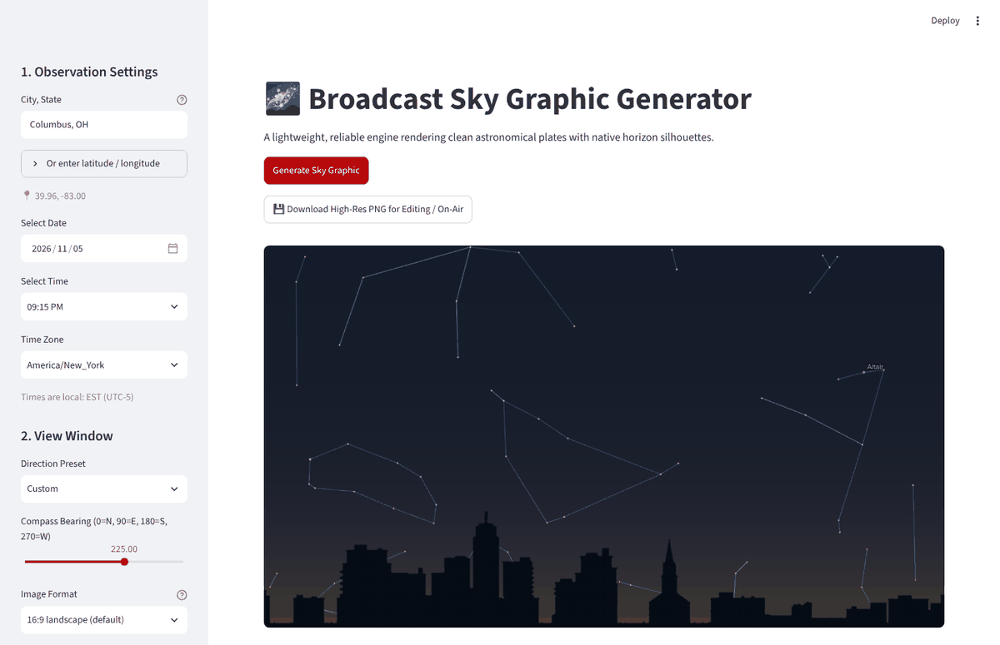
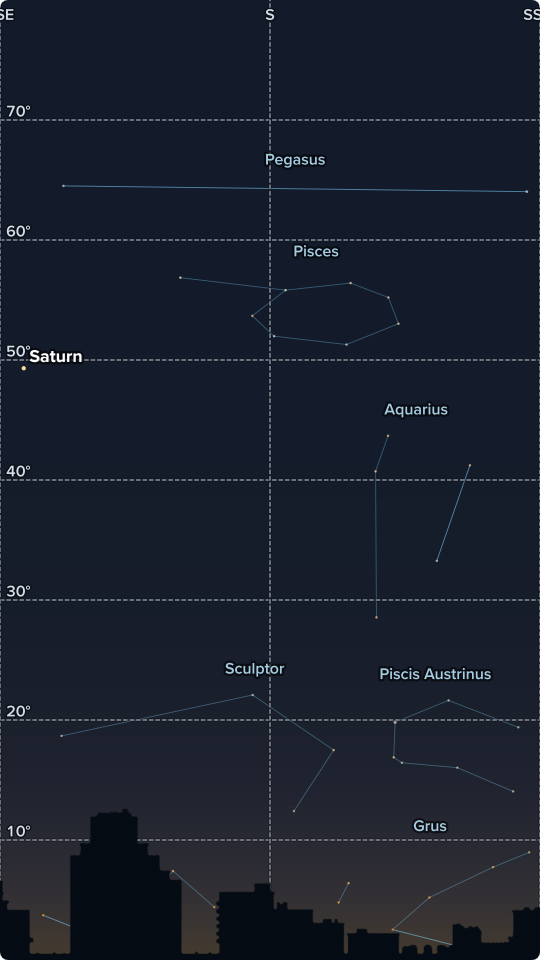
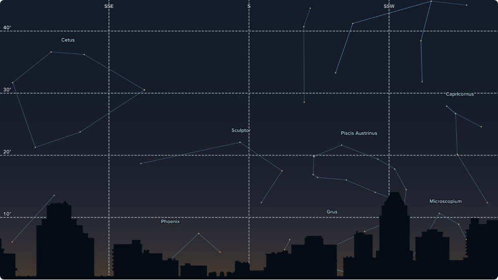

<!--
  Help text for the Astrographics tab (public page and configurator).
  Normal Markdown. Screenshots live in content/images/ and are written as .
  Change the app's address in content/apps.json, not here.
-->
## Astrographics

Astrographics draws the night sky for any place and time: stars, constellations, planets and the Moon, in front of a silhouette of the horizon. You set where, when and which way to look, and it returns a clean, transparent-friendly image to bring into Max or post to social media.

*The app after a first run: Columbus at 9:15 PM, looking southwest, with the skyline as the horizon.*

### What it can do

- **Any place.** Type a city and state, or enter a latitude and longitude. The time zone and the local time follow.
- **Any date and time.** The sky is computed for the moment you pick, including the planets, the Moon and its phase. Refraction near the horizon is included.
- **Which way to look.** Pick North, Northeast and so on, or set an exact compass bearing. The field of view (30 to 180 degrees) and the maximum altitude shown are adjustable.
- **A horizon that fits the place.** Urban, suburban and rural horizon silhouettes are included. Tree foliage can follow the season automatically, or be set to leaves or bare.
- **Sky conditions.** Atmospheric haze and a star visibility limit are suggested from your location (a city sky shows fewer stars than a rural one). Both stay adjustable.
- **Clouds.** Off by default so astronomy graphics stay clear. In Forecast mode it draws the low, mid and high cloud cover from a forecast model (best match, HRRR, GFS or ECMWF) and lets you nudge each layer; Manual lets you set the percentages yourself.
- **Labels and overlays.** Turn planet and Moon labels, major and minor star names, constellation lines and names, asterisms, altitude gridlines and compass lines on or off, and scale the label size from 50 to 300 percent.
- **Four formats.** 16:9 landscape (1920 x 1080, the default), 9:16 vertical for Stories, Reels, TikTok and Shorts (1080 x 1920), 4:5 portrait (1080 x 1350) and 1:1 square (1080 x 1080). Each format has its own natural field of view and label size.
- **Safe zones.** For the social formats, optional red bands show where the apps cover the picture with their own interface.
- **Shareable link.** Every setting is stored in the page address. Copy the address (or the link shown under "Shareable Link") to send or bookmark the exact view.

### How to use it

1. Open the app (button at the top of this tab).
2. Under **1. Observation Settings**, enter the city or coordinates, then the date, time and time zone.
3. Under **2. View Window**, choose a direction and an image format. Adjust the field of view if you want more or less sky.
4. Under **3. Sky Conditions**, check the haze and star settings, the tree foliage, and whether you want clouds.
5. Under **4. Labels & Overlays**, choose what to label.
6. Click **Generate Sky Graphic**. It takes a few seconds.
7. Click **Download High-Res PNG for Editing / On-Air** to save the image, then bring it into Max.

*The vertical format, facing south from Columbus, with constellation names and altitude lines on. Saturn is labeled at the left edge.*

*The 16:9 format with constellation names, altitude gridlines and compass direction lines.*

### Good to know

- The graphic is a computed picture, not a photo. Cloud shapes are illustrative; the amounts and directions follow the forecast or your settings.
- The labels use the station group's Proxima Nova font when the font files are installed in the app.
- The app runs on Streamlit Community Cloud, which puts idle apps to sleep. If you see a "wake up" message, click it and allow about 30 seconds, and open the app before you need it on air.
