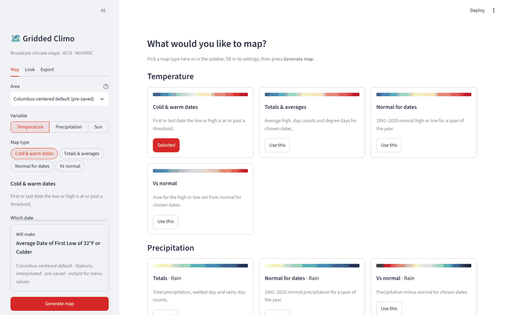
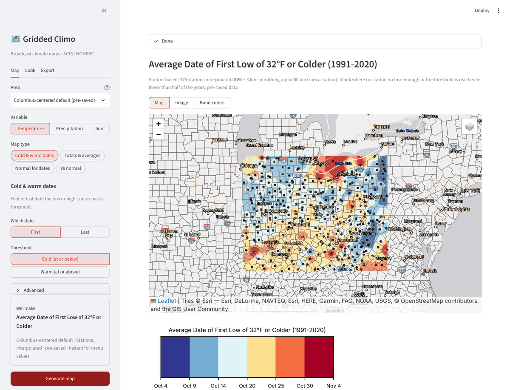
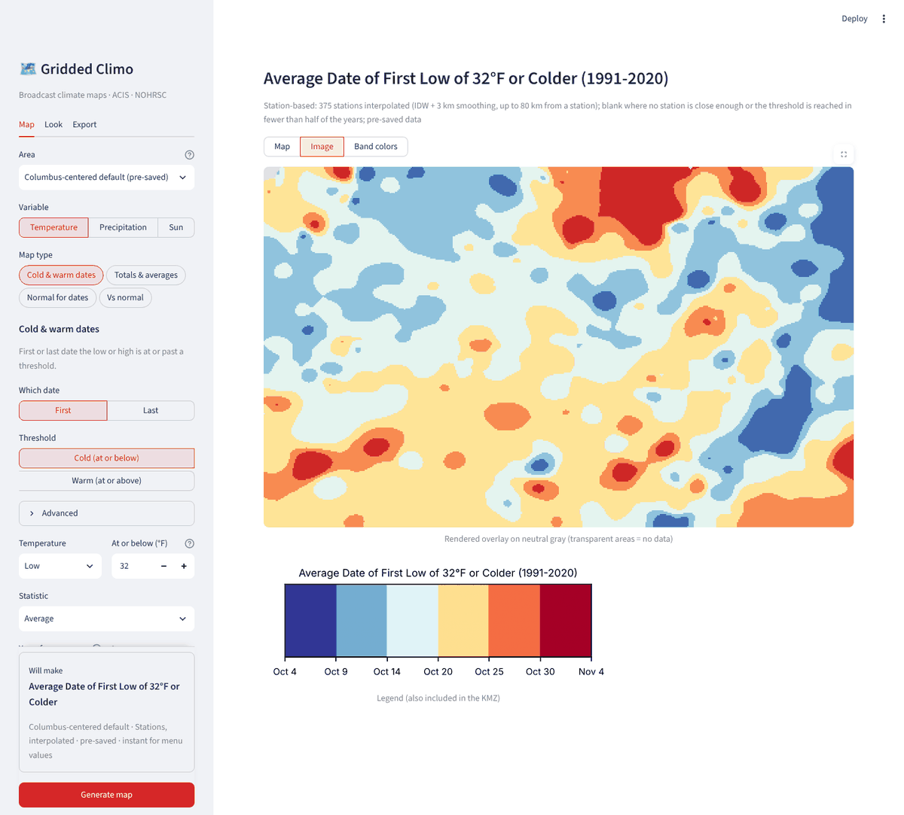
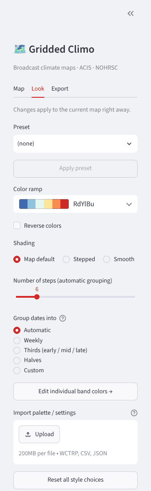

<!--
  Help text for the Gridded Climo tab (public page and configurator).
  Normal Markdown. Screenshots live in content/images/ and are written as .
  Change the app's address in content/apps.json, not here.
-->
## Gridded Climo

Gridded Climo makes climate maps for broadcast: average first and last freeze dates, normals, how far a month ran from normal, snowfall totals, and sunrise and sunset. Each map is colorized, and you download it as a KMZ to use in Max. The default area is Columbus, Ohio, and any state in the lower 48 works too.

*The start screen: pick a map type from the gallery or from the sidebar.*

### What it can do

- **Temperature maps.**
    - *Cold & warm dates:* the first or last date the low or high is at or below, or at or above, a threshold you choose (for example the average first 32 degree low).
    - *Totals & averages:* average high, day counts and degree days for chosen dates.
    - *Normal for dates:* the 1991-2020 normal high or low for a span of the year.
    - *Vs normal:* how far the high or low ran from normal.
- **Precipitation maps.** For rain: totals, normal for dates, and vs normal. For snow: snowfall dates, normal snowfall by month or season, storm totals, and snowfall vs normal.
- **Sun maps.** Sunrise, sunset and day length for one date, or the change between two dates, in local clock time.
- **Any area.** The Columbus-centered default, any state in the lower 48 plus DC, or a custom box.
- **Choose your years.** For date maps, enter a start year (like 1890) or POR, the start of the period of record. The app shows how many stations that start year rests on.
- **Control the look.** Pick a color ramp, reverse it, choose stepped or smooth shading and the number of steps, set the minimum and maximum, and group dates into weekly, thirds, halves or your own bins. You can import a Max palette (`.wctrp`), a CSV legend or saved settings, and edit every band's color by hand.
- **Presets and recent maps.** Save a look as a preset and apply it later. The sidebar lists recent maps so you can re-make one in a click. You can also save a whole map (area, type, settings and look) to reload later.
- **KMZ for Max.** Download the map as a colorized KMZ with its legend included.

### How to use it

1. Open the app (button at the top of this tab).
2. On the **Map** tab in the sidebar, choose the **Area**, then a **Variable** (Temperature, Precipitation or Sun) and a **Map type**.
3. Fill in the short form for that map type: the threshold, the dates or years, the statistic. A "Will make" box at the bottom of the sidebar says exactly what the map will be.
4. Click **Generate map**.
5. Look at the result in the main panel, then switch between **Map** (on a basemap), **Image** (the colored overlay by itself, with its legend) and **Band colors** (edit each color band).
6. On the **Look** tab, adjust the ramp, steps and grouping. Changes apply right away and never refetch the data.
7. On the **Export** tab, click **Download KMZ** and bring it into Max.

*A finished map: the average date of the first low of 32 degrees or colder, 1991-2020, built from 375 stations.*

*The Image view: the colored overlay by itself on a neutral gray, with its legend (the legend is also included in the KMZ).*

*The Look tab: color ramp, shading, steps and how dates are grouped.*

### Good to know

- **Speed.** The Columbus-centered area ships with saved data, so most of its temperature maps are instant. For other states, and for custom date ranges, the app fetches data live from ACIS and NOHRSC, which usually takes 10 to 60 seconds. Long spans in the Ohio region can take longer, and very large areas are capped so the app does not run out of resources.
- **Some maps are Ohio-region only:** the grid-based first and last dates and the normal-period departures need the saved files. Station-based maps, storm-total snowfall and sun maps work anywhere in the lower 48.
- **Maps built from stations** are interpolated between stations and left blank where no station is close enough; the description above the map says how many stations were used.
- The app runs on Streamlit Community Cloud, which puts idle apps to sleep. The first visit wakes it in about 30 seconds, so open it before you need it on air.
