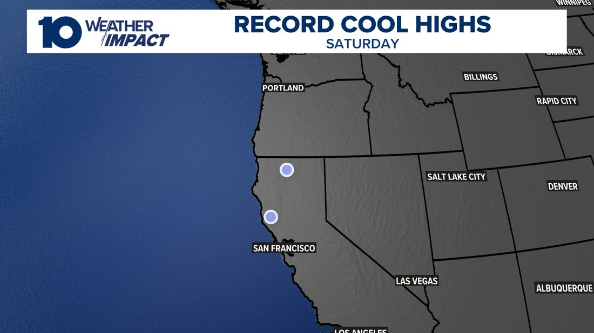
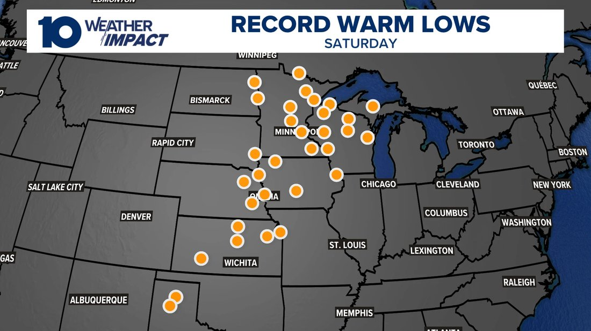
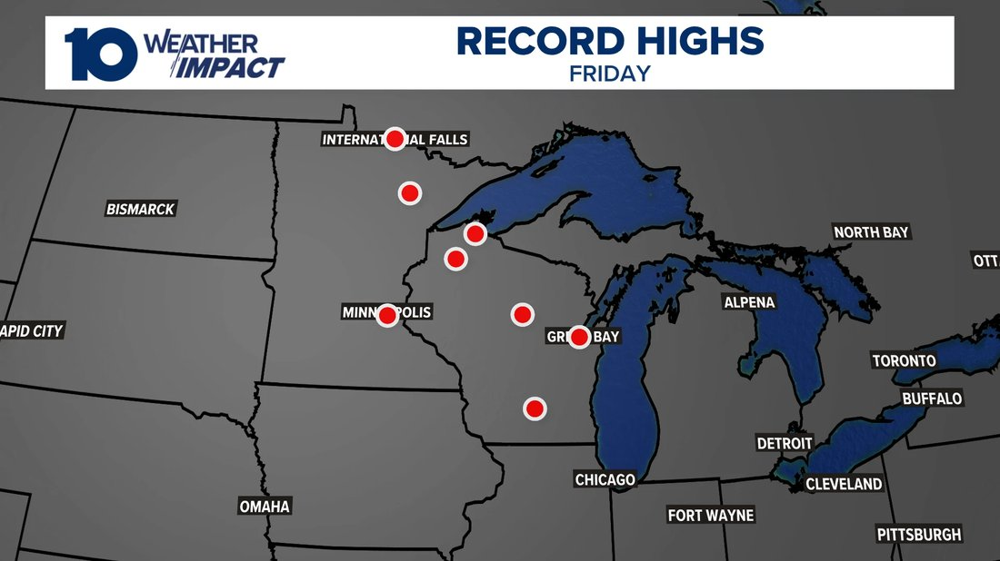
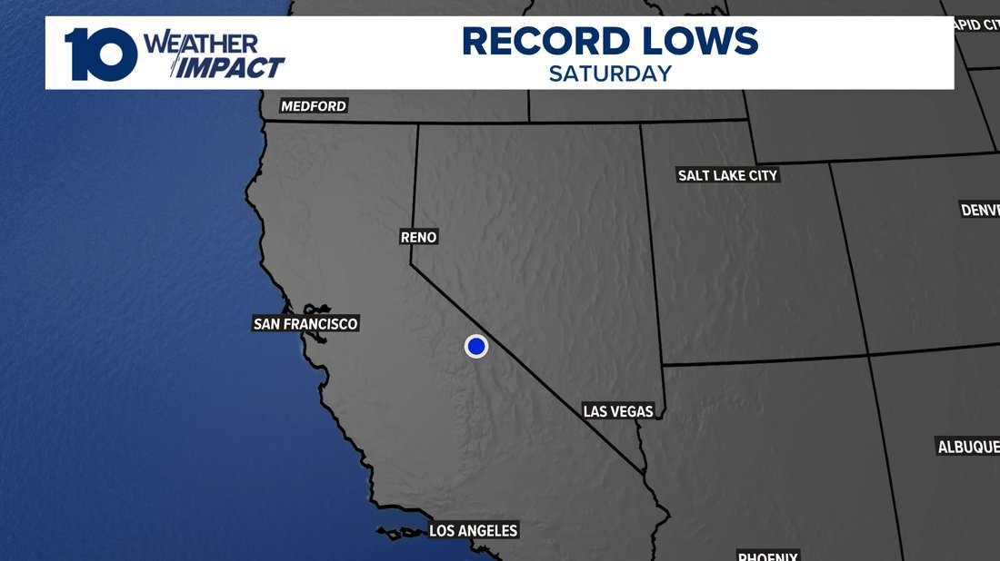

<!--
  Help text for the Record dots tab.
  Shown on the public URL page (Record dots tab) and, later, in the configurator.
  Write normal Markdown. For a screenshot: put the image in content/images/ and write
      
  Commit, and the next build publishes it (within the hour).
-->
Samples of the record dots as they look by default. They are one shared set of layers for every station. If you would rather use a different dot, you can change it in Max; the steps are below.

*Record cool highs.*

*Record warm lows.*

*Record highs.*

*Record lows.*

### Changing how the dots look in Max

1. Check **Disable property changes when KML is updated**.
2. Under the **KML Style** section, click the **Edit Icon** button.
3. Select the icon you would like to use.
