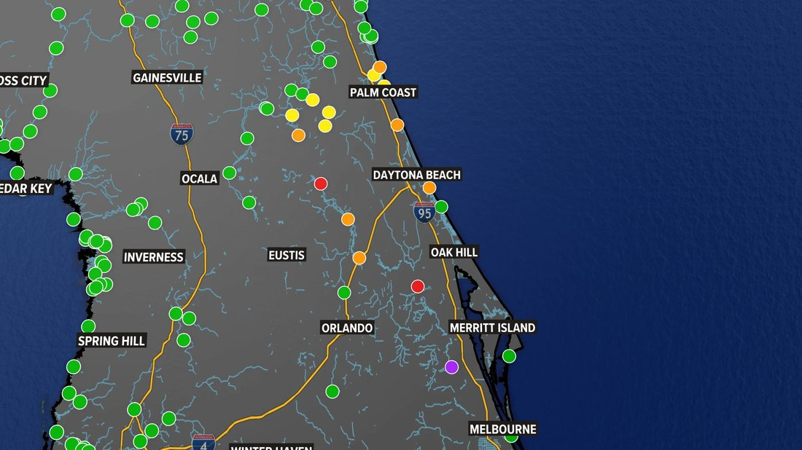

<!--
  Help text for the River flood dots tab (public page). Normal Markdown. Screenshots live in content/images/.
-->

*Sample of the river flood dots in Max over central Florida. Green gauges have no flooding; yellow, orange, red and purple are action, minor, moderate and major flood categories.*
